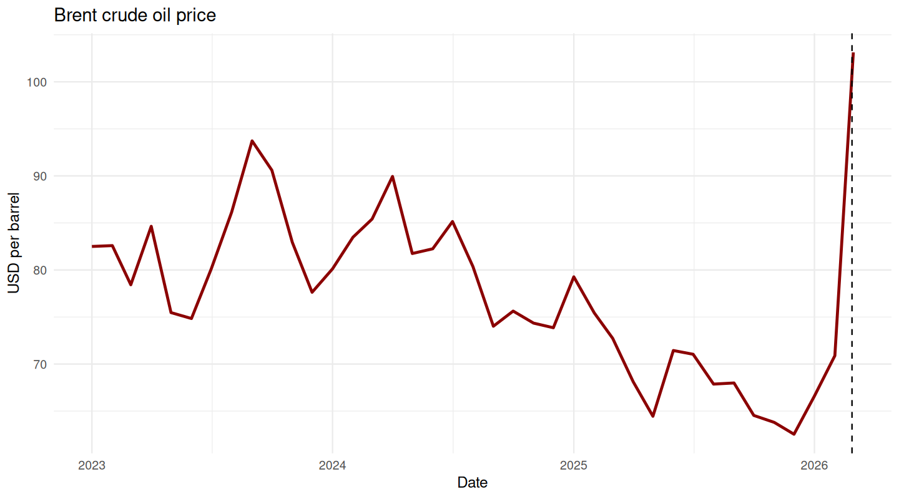
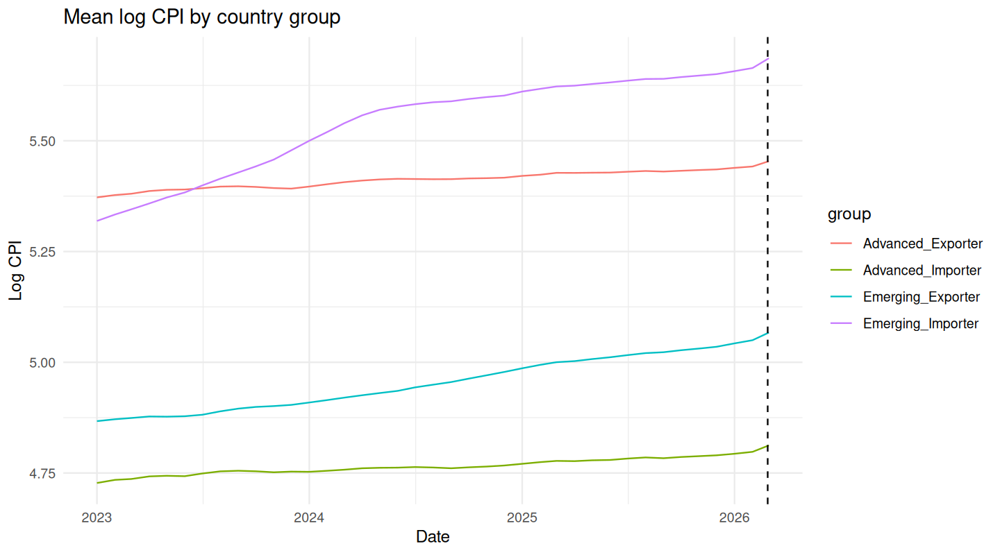

# The Geopolitics of Oil: Macroeconomic Impact & Forecasting

**Advanced Econometrics | R · Panel Data · ARIMA Forecasting**

This academic group project examines associations between macroeconomic indicators and consumer price levels across **12 advanced and emerging economies** around the 2026 Gulf oil-price shock. It combines panel regression, model diagnostics, group comparisons, and short-horizon time-series forecasting.

## Research overview

- **Panel:** 12 countries, monthly observations from January 2023 through March 2026 (468 country-month observations, as reported in the project).
- **Outcome:** natural log of the Consumer Price Index (CPI).
- **Regressors:** oil-price percentage change, nominal effective exchange rate, policy interest rate, global volatility (VIX), and a post-crisis indicator.
- **Estimators:** pooled OLS, country fixed effects, and random effects using R's `plm` package.
- **Diagnostics:** Breusch–Pagan LM, Hausman test, and heteroskedasticity-robust standard errors.
- **Forecasting:** ARIMA projections for CPI and industrial production (IPI), April–June 2026.

## Reported results

The original project report presents a **random-effects specification as preferred** based on the reported Hausman test (p = 0.2727), while the Breusch–Pagan LM test favors a panel specification over pooled OLS. It reports a negative association between the nominal effective exchange rate and log CPI and compares estimates for oil-importing versus oil-exporting economies.

**Interpretation caution:** These results should not be represented as identifying a causal effect of the oil shock. The original report states that the oil-price-change coefficient was not separately estimated and acknowledges endogeneity and the very short observed post-crisis period. ARIMA projections are *univariate forecasts*, not scenario-conditioned estimates of the geopolitical event.

## Visualizations

### Brent crude oil price trend



### Consumer price trends by country group



*Figures are generated by [the R analysis script](src/analysis.R) using the observed dataset. They show descriptive trends, not causal effects.*

## Reproduced model results

The [GitHub Actions regression audit](https://github.com/NouhaBoukhris/geopolitics-of-oil-econometric-analysis/actions/runs/43590270829) executed the reorganized script successfully against the observed 468-row panel.

| Statistic | Reproduced result |
| --- | ---: |
| Hausman test p-value | 0.2727 |
| Breusch–Pagan LM χ² | 6306.2 |
| Random-effects coefficient: log NEER | −1.551583 |
| Random-effects coefficient: policy rate | 0.003177 |
| Random-effects coefficient: VIX | 0.003044 |
| Random-effects coefficient: post-crisis | −0.000296 (p = 0.9824) |

These values agree with the main reported rounded figures. **The oil-price-change term was not estimated** in the model output; the code does not establish the explanation for its omission. Both FE and RE are one-way **country-effects** specifications, not two-way country-and-time fixed effects. Model comparisons and robust standard errors do not establish causal identification.

## Project files

| Path | Description |
| --- | --- |
| [`src/analysis.R`](src/analysis.R) | Reorganized R analysis and ARIMA forecasting script |
| [`src/EconProjFf_original.R`](src/EconProjFf_original.R) | Preserved original academic R script |
| [`data/Gulf_Crisis_Finl.xlsx`](data/Gulf_Crisis_Finl.xlsx) | Observed 468-row panel dataset |
| [`data/panel_data_gulf_crisis_2026.xlsx`](data/panel_data_gulf_crisis_2026.xlsx) | Extended dataset including projected months |
| [`docs/Gulf_Crisis_Final_Report.pdf`](docs/Gulf_Crisis_Final_Report.pdf) | Original final academic report |
| [`docs/R_Output_Screenshot.docx`](docs/R_Output_Screenshot.docx) | Recorded R model output screenshots |
| [`figures/`](figures/) | Reproducibly generated oil-price and CPI trend charts |

## Reproducibility

The reorganized script was executed successfully in [GitHub Actions](https://github.com/NouhaBoukhris/geopolitics-of-oil-econometric-analysis/actions/runs/43590051144), generating 468 processed observations and 72 ARIMA forecast rows. Matching all regression coefficients to the academic report is a separate validation step.

Install R dependencies:

```r
install.packages(c("readxl", "dplyr", "ggplot2", "plm", "lmtest", "stargazer", "forecast"))
```

From the repository root, run:

```bash
Rscript src/analysis.R
```

Generated outputs are written to the ignored `outputs/` folder. The extended dataset includes projected April–June 2026 values and must not be treated as additional observed panel data.

## Contributors

Group project by **Alaa Azouzi, Sarra Alioua, Nouha Boukhris, and Mariem Chammem**, completed for the Advanced Econometrics (BA351) course at Tunis Business School, academic year 2025–2026.

## Limitations

The work uses only one observed post-crisis month in its primary sample. Regression coefficients reflect model associations and rely on assumptions that require further scrutiny; forecasts do not incorporate subsequent observed economic data. The submitted report's numerical findings have not yet been independently reproduced from the accompanying spreadsheets.
